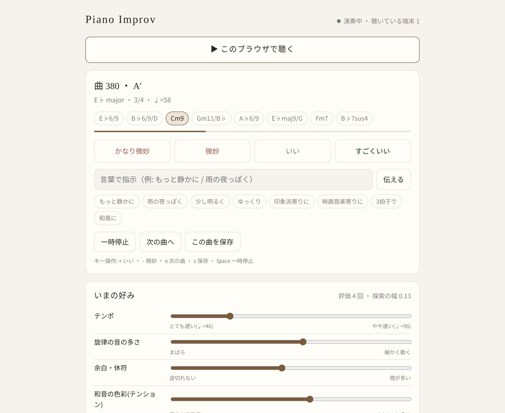
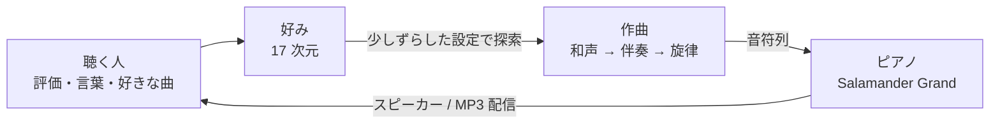

<h1 align="center">Amane</h1>

<p align="center"><sub>天音（あまね）— リポジトリ名は piano-improv ・ <b>v1.0</b>（2026-11-26）</sub></p>

<p align="center"><b>落ち着いて優雅なピアノを、PC でずっと即興で弾き続ける AI。<br>聴きながら「いい」「微妙」と伝えると、だんだん自分の好みに寄っていきます。</b></p>

<p align="center">
  <a href="https://oyako-li.github.io/piano-improv/"></a><br>
  <sub>試聴ページ。本体と同じ画面の並びで、キャラの代わりにピアノの鍵盤がデモに合わせて動きます</sub>
</p>

<p align="center">
  <a href="https://oyako-li.github.io/piano-improv/"></a>
  <a href="#はじめかた"></a>
</p>

- **方向は 2 つ**：印象派（サティ・ドビュッシー的な平行和音・リディア・揺れる maj7）と、日本の映画音楽系（王道進行・IV→IVm→I・カノン風の下降バス・ヨナ抜き）。その間のどこが好きかを、聴きながら探します
- **1 曲に起承転結がある**：起（A）→ 承 → 転（B）で盛り上げて → サビが頂点 → 主題を強く戻して引いていく。盛り上がりの大きさは好みの「ドラマ」で、作業用に平らにもできます（[docs/style.md](docs/style.md)）
- **終わらない**：その曲を、調・拍子・テンポ・動機を変えながら次々に弾きます
- **好みの教え方は 3 つ**：聴きながら評価する／「もっと静かに」「雨の夜っぽく」と言葉で言う／好きな曲を渡す（YouTube などの URL・音声ファイル・MIDI。テンポ・調・和音の色彩・盛り上がりに加えて、和音の進行の型と旋律のリズム・動きの癖を覚えます。旋律そのものは写しません）
- **耳コピ**：チャットで「演奏して ＋ URL」と送ると、その曲を書き起こしてそのまま弾きます（手元で聴くためのもの）
- **好みをしまえる**：いまの好みに名前を付けてしまい、あとで呼び出せます。過去の時刻の好みにも戻せます
- **GPU はいりません**：作曲は音楽理論のルールと乱数。CPU ですぐ動きます。LLM は言葉の解釈に使うこともできる、という程度の任意です
- **音はグランドピアノ**：Salamander Grand Piano（ヤマハ C5 の録音）をサンプル単位のタイミングで鳴らします
- **キャラが弾く 1 画面**：UI サーバーを立てると、3D のキャラクターがピアノを弾く画面と、右側のチャットが 1 画面に収まります。スマホなどから評価や言葉の指示ができ、演奏も MP3 で配信されます

## はじめかた

Linux（PipeWire / PulseAudio）で確かめています。Python 3.11 以上と、配信を使うなら ffmpeg が要ります。

```bash
git clone https://github.com/oyako-li/piano-improv.git
cd piano-improv
python3 -m venv .venv && .venv/bin/pip install -e .
tools/get_piano.sh          # ピアノの音（Salamander Grand Piano, 約 1.2GB）を assets/ に入れる
.venv/bin/piano play        # 弾き始める
```

### ターミナルで聴く・教える

演奏中に打てるもの（入力して Enter）:

| 入力 | 意味 |
|---|---|
| `+` / `++` | いい / すごくいい（いま聴こえている部分の設定の方へ好みを寄せる） |
| `-` / `--` | 微妙 / かなり微妙（その設定から遠ざける） |
| 言葉 | 「もっと静かに」「雨の夜っぽく」「3拍子で」「少し明るく」など。次のセクションから反映 |
| `s` | いま弾いている曲を MIDI で保存（`data/recordings/`） |
| `n` | 次の曲へ |
| `p` | いまの好みを表示 |
| `q` | 終わる |

### ブラウザから操作する

```bash
.venv/bin/piano serve                    # http://127.0.0.1:8765/
.venv/bin/piano serve --no-speaker       # PC では鳴らさず、ブラウザへの配信だけ
```

開くと、3D のキャラクターがピアノの前に座って、聞こえている音に合わせて鍵盤を弾いています。手は届く範囲なら指で取り、届かないときだけ弧を描いて移り、体も弾いている手の方へ寄ります。
「▶ 聴く」で、その端末にも MP3（192kbps）で配信されます。キャラの画面をクリックすると、聴くのを止める / 再開できます（YouTube と同じ）。配信は数秒遅れますが、鍵盤の動きと評価は「その端末で聞こえていた部分」に合わせます。
いまの曲・調・和音、評価、言葉の指示（YouTube などの URL を貼ると、その曲を聴いて曲調を覚えます）、次の曲 / 演奏の一時停止と再開 / MIDI で保存、保存した曲のダウンロード、場面の画像保存と全画面ができます。
キー操作は `+` いい、`-` 微妙、`n` 次の曲、`p` 演奏を止める / 再開、`s` 曲を残す、`Space` 聴く / 止める、`f` 全画面。好みの値を直接動かすスライダーはありません（言葉か評価で伝えます）。

キャラのモデル（VRM）は自分で用意して `data/character.vrm` に置くか、環境変数 `PIANO_VRM` で指定します（このリポジトリには入っていません）。モデルが無くても、キャラが出ないだけで、ほかの操作はできます。
three.js と three-vrm は `pianoimprov/web/vendor/` に同梱しているので、ネットにつながらなくても動きます。

認証はありません。ほかの端末から使うときは、信頼できるネットワークの中だけにしてください（[docs/serve.md](docs/serve.md) に、常駐のさせ方と Tailscale での公開の例があります）。

### そのほかのコマンド

```bash
.venv/bin/piano render -n 2 out.wav     # 2 曲を WAV と MIDI に書き出す
.venv/bin/piano learn 好きな曲.mid ...   # 好きな曲から好みを推定して取り込む（-w で重み）。MIDI・音声・URL を渡せる
.venv/bin/piano show                    # いまの好み
.venv/bin/piano relisten                # 覚えた曲を今の版の推定で聴き直す
.venv/bin/piano reset                   # 好みを初期値に戻す（記録は残る）
.venv/bin/piano snap save 雨の夜        # いまの好みを名前を付けてしまう（data/taste.db）
.venv/bin/piano snap                    # しまった好みと、戻せる日の一覧
.venv/bin/piano snap load 3             # しまった好みを呼び出す（--at "2026-11-24 23:00" でその時刻の好み）
```

音声と URL から推定するには追加の依存が要ります（`pip install -e '.[listen]'` と `pip install --no-deps 'basic-pitch==0.4.0'`）。何を推定してどれだけ当たるかは [docs/listen.md](docs/listen.md) にあります。

チャットで「演奏して ＋ URL」と送ると、その曲を書き起こしてそのまま弾きます（耳コピ）。ピアノ専用の書き起こし Transkun を入れると正確になります（`pyproject.toml` の `cover` の手順。CPU で動きます）。耳コピは手元で聴くためのもので、`data/covers/` と録音は公開しないでください。

言葉の指示は普段キーワード辞書で読みます。辞書で読めない言い回しをローカル LLM に読ませるには、
`PIANO_LLM=gemma3:latest .venv/bin/piano play` のように Ollama のモデル名を渡します。

## 試聴ページ

[oyako-li.github.io/piano-improv](https://oyako-li.github.io/piano-improv/) では、インストールせずにデモ演奏を聴けます。

- 本体の画面と同じ並びです：舞台、いまの曲と和音、プレーヤーの帯、右のパネル（チャット・曲・これは何か）
- 舞台は弾き手の肩越しに見たピアノで、デモの音符に合わせて鍵盤が沈んで光ります（キャラのモデルは公開していません）
- 舞台のクリックか `Space` で聴く / 止める、進行バーのセクションを押すとそこへ飛びます。チャットには、セクションが変わるたびに Amane の一言が出ます
- 評価や言葉の指示は、試聴ページではできません。自分の PC で `piano serve` を動かしてください

## しくみ



- **好み**は、テンポ・音の多さ・余白・和音の色彩・印象派⇔映画音楽・短調の多さ・ペダルなど 17 個の 0〜1 の値です（一覧は [docs/style.md](docs/style.md)）
- 曲ごと・セクションごとに、好みの値のまわりで少しずらした設定を引いて弾きます。評価・言葉・好きな曲は記録に残し、好みはその記録から積み上げます（ベイズの逐次更新。同じ曲は何度渡しても 1 曲分、古いものはゆっくり薄れる）。まだ確かでない値ほど広く試します（[docs/architecture.md](docs/architecture.md)）
- **作曲**は、2 小節の動機を音階上の音程を保ったまま次の和音へ移して繰り返します。強拍は前の音にいちばん近い和音の音へ歩いて着き、4 半音以上動いたら次は反対へ 1 歩で戻ります（跳んで戻るジグザグはしません）。和音ごとに、和音の音と半音でぶつかる音階の音を外した音階を使い、長い旋律音と短 9 度でぶつかる伴奏の内声は抜きます。ペダルは和音が変わるまで響かせます
- **曲の形**は、イントロ → A → A′ → B → サビ → サビ′ → アウトロの起承転結で、セクションごとの勢い（音量・和音の厚さ・低音・アルペジオ・旋律の高さ）を、好みの「ドラマ」の大きさで盛り上げます

モジュールの関係と処理の流れは [docs/architecture.md](docs/architecture.md)、HTTP API は [docs/api.md](docs/api.md) にあります。

## 中身

```
pianoimprov/
  cli.py         コマンド（play / serve / render / learn / relisten / show / reset / snap）
  snapshots.py   好みをしまう所（data/taste.db）
  server.py      UI サーバー（標準ライブラリのみ）・SSE・MP3 配信
  engine.py      演奏の本体：先読み・評価・言葉・一時停止・保存（CLI と UI サーバーの共通部分）
  composer.py    曲とセクションを作る
  theory.py      和音・音階・進行の型
  style.py       好みの 17 次元の定義
  taste.py       好みの保存と学習（data/taste.json, data/ratings.jsonl）
  words.py       言葉 → 好みの変化
  reference.py   好きな曲の MIDI → 好みの推定
  listen.py      好きな曲の音声・URL → 書き起こし → 好みの推定（任意の依存）
  harmony.py     書き起こした音符 → 調と和音の進行の型
  habits.py      書き起こした音符 → 旋律のリズムと動きの癖
  cover.py       耳コピの書き起こし（Transkun / Basic Pitch）と保存
  audio.py       ピアノの音源と出力（pacat / pw-cat、配信用のタップ）
  web/character.html 画面（キャラが弾く・操作もここ）
tools/get_piano.sh  音源のダウンロード
tools/*_stats.py, eval_*.py  作曲と推定を数で確かめる道具（form_stats：曲の形、melody_stats：旋律のつながり、eval_listen など：推定の当たり方）
tools/demo_timeline.py  試聴ページ用に、デモの曲・セクションの時刻と音符を書き出す
docs/          説明と試聴ページ（GitHub Pages。index.html・demo.mp3 / .mid / .json・three.js の同梱）
```

`data/`（自分の好みと評価の記録）と `assets/`（音源）はコミットしません。

## 確かめたこと / まだのこと

- **旋律のつながり**（`tools/melody_stats.py`、初期の好みで 24 曲）：となりの音への動きのうち 2 半音以内が 70.5%、4 半音以上動いてすぐ反対へ 4 半音以上戻るジグザグが 0.0%、6 半音以上の跳躍が 1.9%。旋律と伴奏が半音で隣り合うのは 0.6%
- **曲の形**（`tools/form_stats.py`、音にしてから数える、8 曲）：盛り上がり（音量の山 − 最初の 12 秒）は中央値 +6.4dB。冒頭の主題が後半に戻るのは 8 曲中 7 曲
- **音声・URL からの推定**（[docs/listen.md](docs/listen.md)）：自作の演奏を MP3 にして数えると、テンポは 72 曲中 68 曲で当たり、盛り上がりの大きさは元の値との相関 0.82。和音の進行は半拍ごとの根音で約 8 割当たります。実際の録音で確かめたのはピアノの 3 曲だけで、歌もの・オーケストラは試していません
- 短調の多さ・跳躍は、1 曲の音から好みを当てるのに限界があります（同じ曲の MIDI からでも同じくらい外れる）
- 音楽として好みかどうかは、聴いてみないと分かりません。[試聴ページ](https://oyako-li.github.io/piano-improv/)に、v1 が初期設定のまま弾いた 3 曲（7 分 10 秒）があります

## この先（v2 の候補）

- **和音が次へ引っぱる**：次の和音へ向かう属七（V/V など）と、同主短調から借りる和音（♭VI・♭VII・iv）を、好みの値として増やせるようにする。いまは調の中の 4〜8 和音の繰り返しが中心で、ゲーム音楽のような「次へ進みたくなる」緊張が出ない
- **テンポと山の大きさ**：テンポの上限（♩=96）を広げる。いまの山は +6〜7dB ほどで、参考に測ったゲーム音楽の 1 曲（+12.9dB・音量の幅 22dB）より小さい。山のあとに、ほとんど音のない静かな終わりを置く
- **駆け上がる旋律**：ジグザグは禁じたまま、和音の音を一方向に上がって頂点へ向かう線と、拍頭での同じ音の連打を許す
- 評価が溜まったら、評価を予測するモデル（ガウス過程など）で探索を賢くする
- ルールの作曲に加えて、好きな曲で微調整した記号音楽モデルに旋律を任せる
- MIDI キーボードの入力に応える

## ライセンス

- プログラム：MIT License（[LICENSE](LICENSE)）
- ピアノの音：[Salamander Grand Piano](https://freepats.zenvoid.org/Piano/acoustic-grand-piano.html)（Alexander Holm、CC BY 3.0）。このリポジトリには入っていません。`tools/get_piano.sh` が FreePats の SF2 版を取ってきます
- 試聴ページの演奏（`docs/demo.mp3`）：このプログラムが作曲し、Salamander Grand Piano で鳴らしたものです。音源のクレジット（Alexander Holm, CC BY 3.0）を添えれば、自由に使って構いません。楽譜（`docs/demo.mid`）は CC0 です

---

**Amane** v1.0 (repo: piano-improv) — an AI that improvises calm, elegant piano music forever, somewhere between Impressionism (Satie, Debussy) and Japanese film scores, and learns your taste as you listen. Rate what you hear (`+` / `-`), tell it in words ("quieter", "like a rainy night"), or give it songs you like (a YouTube URL, an audio file, or MIDI) and it picks up their tempo, mode, harmonic color, dynamic arc, chord progression patterns and melodic rhythm. Composition is rule-based music theory plus randomness (no GPU), played with the Salamander Grand Piano. Run `piano play` in a terminal or `piano serve` for a browser UI with MP3 streaming. [Listen to a demo](https://oyako-li.github.io/piano-improv/). See [AGENTS.md](AGENTS.md) for notes aimed at AI coding assistants.
