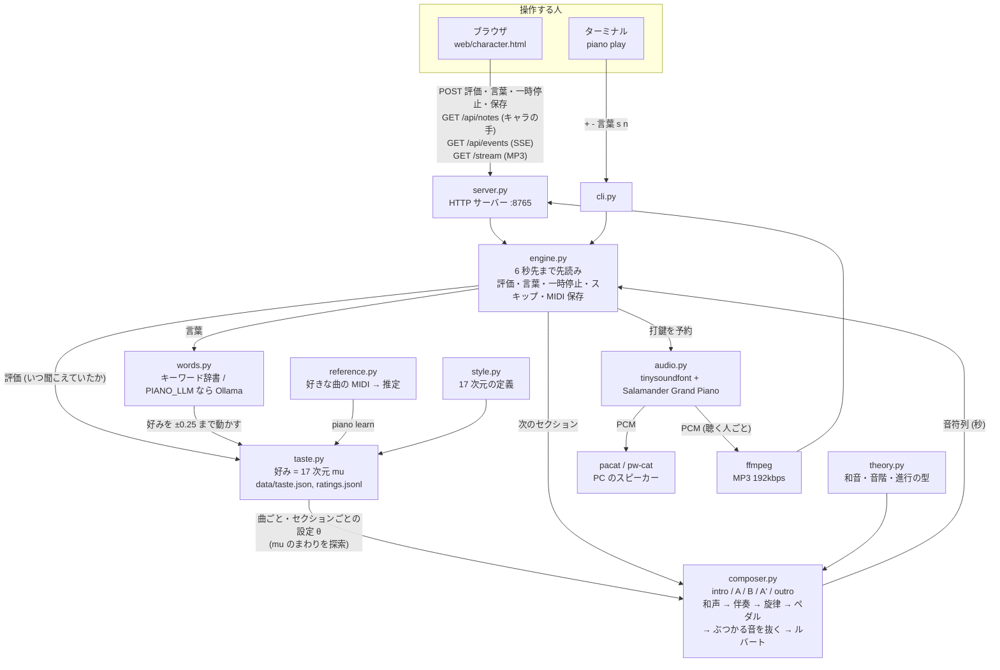

# しくみ

## モジュールの関係

## 1. 好み（`taste.py`、`style.py`）

- 好みは 0〜1 の値 17 個それぞれの「平均 `mu` と不確かさ `sd`」です。各値の意味は [style.md](style.md)
- **記録が本体**です。評価・言葉・好きな曲・reset は、すべて出来事として `data/ratings.jsonl` に残し、好みはその記録を頭から積み上げて作ります（ベイズの逐次更新。次元ごとの正規分布）。`data/taste.json` は今の好みの写しです。だから学び方や曲の推定を直したら、記録から作り直せます
  - **好きな曲**：推定した値を、その次元の推定の誤差（[listen.md](listen.md)）と「1 曲は好みの一部」の幅（0.15）で観測します。同じ曲（同じ URL）は、何度渡しても最後に聴いた 1 回だけが効きます
  - **「いい」**：聴いていたセクションの θ を観測します（評価が強いほど確か）。**「微妙」**：θ から `0.15 · |r|` だけ遠ざけます
  - **言葉**：「その時の好み ＋ 変化量」を強めに（幅 0.12）観測します
  - **忘却**：出来事 1 つごとに、確かさの 1 割を初期へ戻します（半減は約 7 件）。好みが変わっても付いていけるように
- 曲ごとに `mu` のまわりで少しずらした設定 θ を引きます（調・拍子・テンポなど曲全体で固定する値）。セクションごとにも、その半分の幅でさらにずらします。ずらす幅は次元ごとに `0.6 · sd`（0.05〜0.16）で、まだ確かでない次元ほど広く試します
- **渡した曲に寄せる**：好みは全部の曲をならした値なので、1 曲渡しても 2 割ほどしか動きません（5 曲目で約 16%）。そこで曲を渡したら、いまの曲を締め、次の曲からしばらくその曲の推定値を中心に弾きます（1・2 曲目は全部、3 曲目 6 割、4 曲目 3 割、そのあと好みへ戻る）。寄せている間の言葉・スライダーは寄せ先にも効きます。記録には残しません（再起動で終わる）。夜の向日葵（♩81）で、amane の演奏を同じ推定で読み直すと、7 つの値の曲との差が平均 0.20 → 0.12（3 seed）になりました
- **進行も借りる**：曲を聴くとき、書き起こしから調と和音の進行も読みます（`harmony.py`）。寄せの強い 1〜3 曲目は、その曲の調・長短で、よく繰り返す 4 つの和音を A（と前奏）、次に多い 4 つを S（サビ）の進行にします。B は amane 自身の進行のままです。旋律の癖（1 拍の中のリズムの並びと、音階で何歩動くかの割合。`habits.py`）も読み、amane 自身の癖と半分ずつ混ぜて旋律づくりに使います（旋律そのものは写しません）。読み取りの当たり方は [docs/listen.md](listen.md)
- **耳コピ**：「演奏して ＋ URL」で、曲を頭から（6 分まで）書き起こしてそのまま弾き、そのあとはその曲に寄せて即興します（`engine.perform`）。書き起こしはピアノ専用の Transkun（入っていなければ Basic Pitch）。耳コピは曲ごとに `data/covers/` に残し、同じ曲はそれを弾きます（`cover.py`。当たり方は docs/listen.md）
- **しまう・呼び出す**：好み（mu と確かさ）は名前を付けて `data/taste.db`（SQLite）にしまえます。呼び出すと記録に `load`（その好みの中身ごと）を書き、そこから積み上げ直します。記録は消さないので、呼び出す前の好みにも戻れます。記録から過去の任意の時刻の好みも作り直せるので、日ごとの時点はしまわなくても戻せます（`Taste.state(at)`）
- `piano relisten` は、覚えた曲を今の版の推定で聴き直します（推定を直したあとに）
- 前の方式（曲を渡すたびに重み 0.5 で寄せる）と、模擬の聴き手で比べた結果（`tools/eval_taste.py --users 100`、本当の好みとの平均絶対誤差。推定できる 7 次元 / 全 17 次元。忘却の強さは seed 1 で決め、seed 2 で確かめた）：

| 場面 | 前の方式 | 今の方式 |
|---|---|---|
| 好きな曲を 8 曲 | 0.116 / 0.156 | 0.076 / 0.140 |
| 同じ曲を 3 回重ねる | 0.178 / 0.182 | 0.076 / 0.140 |
| 曲 6 曲と評価 40 回 | 0.111 / 0.145 | 0.085 / 0.131 |
| 途中で好みが変わる | 0.119 / 0.163 | 0.103 / 0.156 |

  （seed 2 の結果。模擬の聴き手の仮定（曲のずれ 0.15、推定の誤差）は、この方式を決めたのと同じものなので、実際の人で当たるとは限りません）

## 2. 作曲（`composer.py`、`theory.py`）

曲は intro → A → B → A' → outro。調・拍子・テンポ・動機は曲ごと、和声・伴奏・旋律はセクションごとに作ります。1 セクションは次の順に作ります。

1. **和声**：映画音楽系か印象派系か（`impressionism`）、長調か短調かで、進行の型を選びます。`color` が高いほど maj7・add9・11th などの響きが増えます
2. **伴奏**：アルペジオ・揺れ・刻み・和音を置く、のどれか（`flow`）
3. **旋律**：2 小節の動機を、音階上の音程を保ったまま次の和音へ移して繰り返します。強拍は和音の音、弱拍は順次進行、跳躍のあとは反対へ戻ります。同じ音の連打には罰を与え、音域の端では跳ね返します
4. **ペダル**：和音が変わるまで響かせます
5. **ぶつかる音を抜く**：長い旋律音と短 2 度・短 9 度でぶつかる伴奏の内声を抜きます
6. **ルバート**：テンポを揺らして、拍を秒に直します

GPU も LLM も使いません。1 セクションは CPU で一瞬で作れます。

## 3. エンジン（`engine.py`）

- 別スレッドで、6 秒先まで作曲してはピアノに打鍵を予約し続けます
- どのセクションをいつ鳴らしたか（サンプル位置）を記録しています。評価は「その時点で聞こえていたセクション」に付きます。ブラウザの配信は数秒遅れるので、ブラウザは自分が聞いていた時刻を一緒に送り、エンジンはその時刻のセクションに評価を付けます
- 一時停止・次の曲・保存（いまの曲を MIDI に書き出す）もここで扱います。CLI と UI サーバーはどちらもエンジンを操作するだけです

## 4. 音（`audio.py`）

- Salamander Grand Piano の SF2 を tinysoundfont で、サンプル単位のタイミングで鳴らします（打鍵を時刻順のヒープに積み、ブロックを分けて正確な位置で鳴らす）
- 出力は 2 つ
  - **PC のスピーカー**：`pacat`（PulseAudio / PipeWire）か `pw-cat` に流します
  - **配信**：聴く人ごとにタップ（キュー）を作り、ffmpeg で MP3 にして `/stream` から流します
- `--no-speaker` のときは、スピーカーには出さず、時計に合わせて配信だけします

## 5. 言葉と好きな曲

- **言葉**（`words.py`）：正規表現のキーワード辞書で、好みの変化量に直します（例：「静か」→ softness +0.2, density −0.1, tempo −0.05）。1 回で動かす量は各値 ±0.25 まで。環境変数 `PIANO_LLM` に Ollama のモデル名を入れたときだけ、辞書で読めない言い回しを LLM に読ませます
- **好きな曲**（`reference.py`）：MIDI から調（Krumhansl のキープロファイル）を推定し、旋律のトラック（なければ一番上の音）から、色彩・跳躍・音の多さ・音域を見積もって好みに混ぜます
