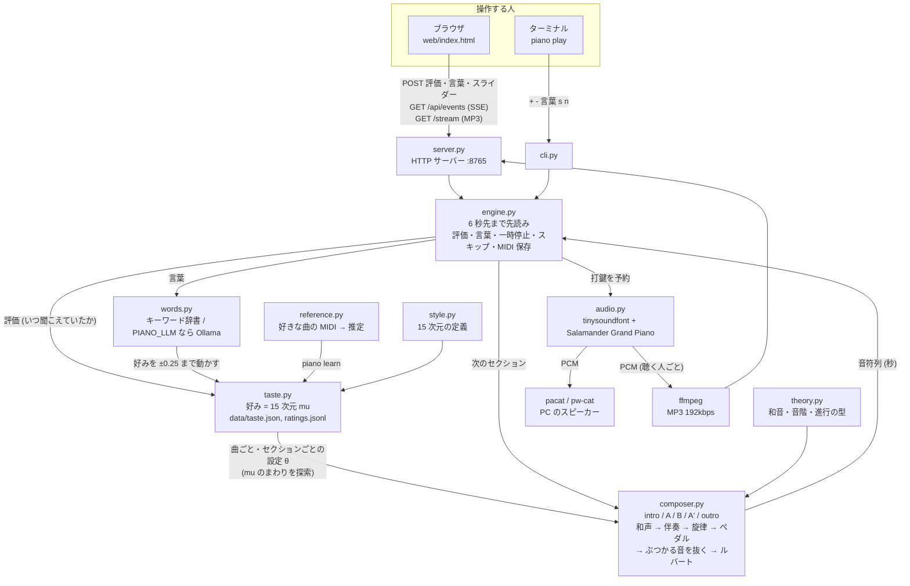

# しくみ

## モジュールの関係

## 1. 好み（`taste.py`、`style.py`）

- 好みは 0〜1 の値 15 個の中心 `mu` です（`data/taste.json`）。各値の意味は [style.md](style.md)
- 曲ごとに `mu` のまわりで少しずらした設定 θ を引きます（調・拍子・テンポなど曲全体で固定する値）。セクションごとにも、その半分の幅でさらにずらします
- ずらす幅は `max(0.05, 0.16 / sqrt(1 + n/8))`（n は評価の回数）。評価が増えるほど狭まります
- 評価 r（-2〜2）が付くと `mu += lr · r · (θ − mu)`。良いときは lr = 0.3、悪いときは 0.15 で、聴いていたセクションの θ へ寄せる・遠ざけます
- 評価・言葉・スライダーの操作は、すべて `data/ratings.jsonl` に残ります

## 2. 作曲（`composer.py`、`theory.py`）

曲は intro → A → B → A' → outro。調・拍子・テンポ・動機は曲ごと、和声・伴奏・旋律はセクションごとに作ります。1 セクションは次の順に作ります。

1. **和声**：映画音楽系か印象派系か（`impressionism`）、長調か短調かで、進行の型を選びます。`color` が高いほど maj7・add9・11th などの響きが増えます
2. **伴奏**：アルペジオ・揺れ・刻み・和音を置く、のどれか（`flow`）
3. **旋律**：2 小節の動機を、音階上の音程を保ったまま次の和音へ移して繰り返します。強拍は和音の音、弱拍は順次進行、跳躍のあとは反対へ戻ります。同じ音の連打には罰を与え、音域の端では跳ね返します
4. **ペダル**：和音が変わるまで響かせます
5. **ぶつかる音を抜く**：長い旋律音と短 2 度・短 9 度でぶつかる伴奏の内声を抜きます
6. **ルバート**：テンポを揺らして、拍を秒に直します

GPU も LLM も使いません。1 セクションは CPU で一瞬で作れます。

## 3. エンジン（`engine.py`）

- 別スレッドで、6 秒先まで作曲してはピアノに打鍵を予約し続けます
- どのセクションをいつ鳴らしたか（サンプル位置）を記録しています。評価は「その時点で聞こえていたセクション」に付きます。ブラウザの配信は数秒遅れるので、ブラウザは自分が聞いていた時刻を一緒に送り、エンジンはその時刻のセクションに評価を付けます
- 一時停止・次の曲・保存（いまの曲を MIDI に書き出す）もここで扱います。CLI と UI サーバーはどちらもエンジンを操作するだけです

## 4. 音（`audio.py`）

- Salamander Grand Piano の SF2 を tinysoundfont で、サンプル単位のタイミングで鳴らします（打鍵を時刻順のヒープに積み、ブロックを分けて正確な位置で鳴らす）
- 出力は 2 つ
  - **PC のスピーカー**：`pacat`（PulseAudio / PipeWire）か `pw-cat` に流します
  - **配信**：聴く人ごとにタップ（キュー）を作り、ffmpeg で MP3 にして `/stream` から流します
- `--no-speaker` のときは、スピーカーには出さず、時計に合わせて配信だけします

## 5. 言葉と好きな曲

- **言葉**（`words.py`）：正規表現のキーワード辞書で、好みの変化量に直します（例：「静か」→ softness +0.2, density −0.1, tempo −0.05）。1 回で動かす量は各値 ±0.25 まで。環境変数 `PIANO_LLM` に Ollama のモデル名を入れたときだけ、辞書で読めない言い回しを LLM に読ませます
- **好きな曲**（`reference.py`）：MIDI から調（Krumhansl のキープロファイル）を推定し、旋律のトラック（なければ一番上の音）から、色彩・跳躍・音の多さ・音域を見積もって好みに混ぜます
